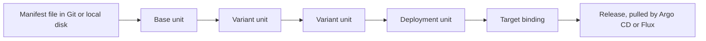
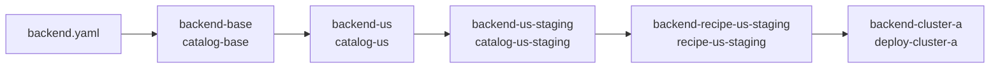
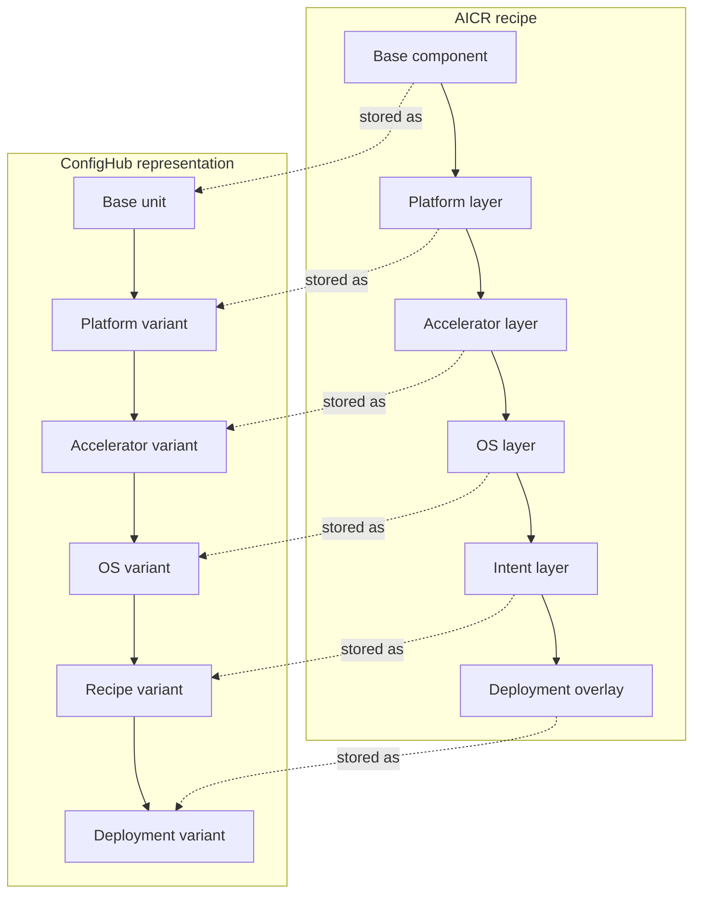
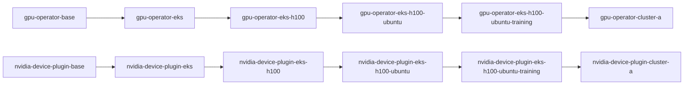

# How This Works

This document explains the mechanics behind the four `global-app-layer` examples: how manifests move through ConfigHub, how name conflicts are avoided, how configuration reaches a cluster, and where AI fits.

## 1. Config Manifests live in the Database

Every piece of Kubernetes YAML lives in ConfigHub as a **unit** — a versioned, content-addressed blob. The lifecycle is:



The user-facing idea is a **layered variant chain**:

- one base unit
- one more specialized variant at each layer
- one final deployment unit

The underlying ConfigHub mechanism is a set of **clone links** between those units. That is how shared updates can flow downstream with provenance.

### `single-component`: one layered variant chain



Layer-by-layer, that means:

- `backend-base`: original manifest stored as a unit
- `backend-us`: region specialization
- `backend-us-staging`: role specialization
- `backend-recipe-us-staging`: recipe-level shared intent
- `backend-cluster-a`: final deployment-specific variant

Each variant is a new revision that inherits its parent’s data. Mutations are applied via `cub function do`, which writes a new revision to the unit. The database tracks every revision with a content hash.

The **recipe manifest** unit is separate metadata in the recipe space. It is not another executable layer. It is the receipt that records the full provenance: which spaces, units, revisions, and hashes compose the recipe.

When you change the base, the change propagates down through clone links. When you mutate a leaf, only that leaf changes. The database holds the complete history.

### Terms that matter later

Before getting to live delivery, keep these terms separate:

- `recipe` = the layered app intent plus the provenance record that explains the
  assembled app
- `deployment variant` = the final executable unit that can be bound to a
  target
- `bundle` = a deployable artifact produced for a controller-oriented path,
  usually an OCI artifact
- `bundle evidence` = receipts around that artifact such as digests, checksums,
  SBOMs, attestations, or GUI views

This package proves the recipe and deployment-variant story directly. The bundle
and bundle-evidence story is real too, but only on the example paths that
explicitly show controller-side proof.

## 2. How NVIDIA AICR Layers Map to ConfigHub

NVIDIA AICR talks about layers.
ConfigHub stores one unit at each specialization stage.



For the GPU example that becomes:



The important shift is:

- AICR describes a stack as layers
- ConfigHub stores each layer outcome as a real unit
- clone links record how one specialized variant came from an earlier one

## 3. Delivery: Releases and Targets

Traditional GitOps sources YAML from Git. In ConfigHub, units are the deployment manifests themselves, and they reach a cluster as **Releases**.

A **Target** names where a Space's configuration is destined. Each deployment Space has a release Target, set with `cub space update <space> --release-target <space/target>`. `cub release publish <space>` then bundles the Units in that Space that are assigned to the Target, at a point in time, and serves the bundle from ConfigHub's OCI registry. A GitOps tool in the cluster pulls it:

```
ConfigHub (materialized raw Kubernetes YAML)
    → Release, served from ConfigHub's OCI registry
        → Flux OCIRepository or Argo CD Application with an OCI source
            → Flux or Argo CD reconciles workloads in the cluster
```

The identity that pulls is a service account with View and ViewChildren on the Target. argobot runs in the cluster and syncs the Argo CD Application or Flux source when a Release is published, so a change shows up without waiting for the next poll.

The layered variant chain is the same whichever tool pulls. The Flux and Argo deployment variants at the leaf of `single-component` and `gpu-eks-h100-training` carry what each tool needs. The direct variant holds plain manifests; ConfigHub no longer applies to a cluster itself, so it is delivered through a Release like the others.

**Proof requirements:**

| Delivery Mode | What to show |
|---------------|--------------|
| Flux OCI | Release published, OCI ref/digest, Flux reconciliation evidence, live cluster resources |
| Argo OCI | Release published, Argo `Application` with OCI source, Argo reconciliation evidence, live cluster resources |

A full proof runs from ConfigHub revision to OCI ref/digest to controller source to live workload evidence.

### Label Mapping (Open Design Question)

When ArgoCD Applications carry labels like `team=payments` or `env=prod`, there is currently no deterministic convention for how those map to ConfigHub spaces and unit labels. This is a known gap. The labels are preserved in imported YAML but don't yet influence ConfigHub organizational placement.

## 4. Role of AI

ConfigHub does **not use AI internally** but we recommend using it to "drive" the management plane and config data APIs.

ConfigHub mutations are explicit, deterministic function calls:

| Function | What it does |
|---|---|
| `set-env` | Set an environment variable on a container |
| `set-replicas` | Set replica count on a Deployment/StatefulSet |
| `set-namespace` | Set the metadata.namespace on all resources |
| `set-string-path` | Set any string value at an arbitrary YAML path |

Same input always produces same output. No model inference, no probabilistic output, no training data dependency.

Where AI fits in the ConfigHub vision is **operating assistance** — helping humans design layered variant chains, choose which mutations to apply at which layer, generate recipe manifests, and reason about config drift. Eg Helm is a deterministic generator that could be AI-assisted (e.g., "given this Helm chart, propose a layered chain").

In this demo our example scripts were written with AI assistance (designing the layering structure, debugging deployment failures, creating stub dependencies, iterating on the chain design). But the artifacts produced are plain bash scripts calling deterministic CLI commands. There is no AI in the loop at runtime.

## 5. Avoiding Name Conflicts

Each recipe run gets a random prefix (e.g. `hug-hug`, `den-cub`, `roll-cub`, `berry-sun`) generated by `cub space new-prefix`. Every space name is `{prefix}-{suffix}`:

- `hug-hug-catalog-base`, `hug-hug-deploy-cluster-a` (single-component)
- `den-cub-catalog-base`, `den-cub-deploy-cluster-a` (frontend-postgres)

This means four recipes create ~20 spaces with zero name collisions.

On the cluster side, `DEPLOY_NAMESPACE` is overridable (`recipe-sc`, `recipe-fp`, `recipe-ra`, `recipe-gpu`), so each recipe's pods land in a different namespace.

Unit names within a space are fixed per-component (`backend-base`, `frontend-cluster-a`) — they don't conflict because they live in prefix-scoped spaces.
