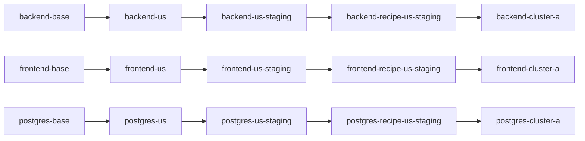

# `realistic-app`

This worked example extends [frontend-postgres](../frontend-postgres/README.md) into a fuller `global-app` recipe with three coordinated components:

- `backend`
- `frontend`
- `postgres`

It keeps the same recipe model:

- `variant` = a unit specialized from an earlier unit
- `clone link` = the ConfigHub mechanism that keeps it connected upstream
- `deployment variant` = the final unit you can bind to a target and deploy
- `bundle` = a deployable artifact produced for a controller-oriented target
- `bundle evidence` = receipts about that artifact, such as digests, SBOMs,
  attestations, or GUI views

The recipe is still the ordered chain of variants plus the app-level provenance
record, not the bundle. What changes here is that the layer model now governs a
recognisable small app, not just a pair of components.

## What This Example Is For

Use this when you need the clearest layered recipe story that still feels like a real application.

This example exists to prove that the same chain model can govern a backend, frontend, and database together, and then carry that app cleanly into the live deployment follow-on path.

## Stack And Scenario

This example is for:
- ConfigHub-managed Kubernetes application manifests
- a small three-tier app recipe
- safe app-level layered propagation across backend, frontend, and database

If this is your first example, read [What an app looks like here](../../catalog/FIRST_APP.md)
first. It starts with a read-only plan and a local frontend replica diff, so
you can see the app and make one visible config change before creating
ConfigHub objects.

## The App And Its Boundaries

The source inputs are already Kubernetes objects, sometimes called flattened
manifests: they are concrete Deployment, Service, Ingress, and StatefulSet
objects rather than chart templates. They still contain a placeholder
namespace and development settings, so they are not ready to apply unchanged.
The three components are:

- `frontend`: Deployment and ClusterIP Service, exposed through an Ingress
- `backend`: Deployment and ClusterIP Service, with an API Ingress; its
  `DATABASE_URL` points to the Postgres Service
- `postgres`: single-replica StatefulSet and Service with a persistent volume
  claim template; its database, user, and password match the backend example

The images and application code belong to [Cubbychat](https://github.com/confighub/cubbychat).
This repository demonstrates how to manage the Kubernetes configuration for
those components. ConfigHub stores and versions the Units, layer ancestry,
and recipe provenance. A Kubernetes target or a GitOps controller performs
delivery; setup alone does not apply the app, and successful Unit verification
does not show that the app is serving requests.

## Start Locally, Then Transfer The Pattern

For the first useful result, follow [the first-app guide](../../catalog/FIRST_APP.md):
inspect `--explain-json`, then run its local frontend replica comparison. It
shows the exact Deployment field changing from one replica to two and writes
only to a temporary copy. This gives you a concrete understanding of the app
configuration before choosing whether to materialize it in ConfigHub.

To adapt the example to your own app, replace the three base manifests with
your app's concrete component manifests, then update the recipe's component
names and cross-component settings (for example, the backend database URL and
the database name). Keep each component's base config separate from the
region, role, recipe, and deployment choices. Use the read-only plan to check
the spaces and resulting Unit names before running setup. Your app source,
image build, credentials, and delivery controller remain part of your own
application and delivery workflow.

## What You Need Installed

- `cub` in `PATH`
- an authenticated ConfigHub CLI context for any mutating step
- `jq` for the JSON preview path
- optional: a live target only if you want to bind and apply

## What This Reads And Writes

What it reads:
- `../baseconfig/backend.yaml`
- `../baseconfig/frontend.yaml`
- `../baseconfig/postgres.yaml`
- current ConfigHub context and optional target ref

What it writes:
- five ConfigHub spaces with a shared prefix
- units for each layer of each component
- one deployment-bootstrap namespace unit for the live path
- clone links / variant ancestry
- one app-level recipe manifest
- optional target bindings
- optional live deployment state only if you explicitly bind and apply

## What You Should Expect To See

In ConfigHub-only mode:
- five spaces sharing one prefix
- three coordinated layered chains
- one recipe manifest unit
- `verify.sh` passing

In live mode:
- deployment units bound to a target
- a published Release (`cub release publish`)
- the Release pulled by Argo CD or Flux in the chosen target path

## AI-Safe Path

If you want to use this example with an AI assistant, start here:

- [AI_START_HERE.md](./AI_START_HERE.md)
- [prompts.md](./prompts.md)
- [contracts.md](./contracts.md)

If you want the full lifecycle after setup + verify, including live deployment, shared updates, and a custom downstream deployment variant, use:

- [../whole-journey.md](../whole-journey.md)

## What It Builds

Three components from `global-app`:

- `../baseconfig/backend.yaml`
- `../baseconfig/frontend.yaml`
- `../baseconfig/postgres.yaml`

Each component gets a materialized chain in the same five spaces:



Shared spaces:

- `catalog-base`
- `catalog-us`
- `catalog-us-staging`
- `recipe-us-staging`
- `deploy-cluster-a`

The example also writes one explicit app-level recipe manifest unit into the recipe space:

- `recipe-us-staging-realistic-app`

And one deployment bootstrap unit into the deploy space:

- `cluster-a-namespace`

That manifest records the layer provenance for all three components together. The variant chains are what ConfigHub executes; the recipe manifest is the receipt that explains the assembled app.

The recipe source has two forms:

- [recipe.base.yaml](./recipe.base.yaml): placeholder-based base recipe for the whole app
- `.state/recipe-us-staging-realistic-app.rendered.yaml`: rendered concrete recipe instance for this run

## Layer Semantics

Shared layer names:

- `base`
- `region`
- `role`
- `recipe`
- `deployment`

Component-specific mutations:

- `backend`
  - `region`: set `REGION=us` and backend ingress host
  - `role`: set `replicas=2` and `ROLE=staging`
  - `recipe`: set an explicit backend `DATABASE_URL` for `chatdb` and set `CHAT_TITLE`
  - `deployment`: set namespace, deployment host, and `CLUSTER=cluster-a`
- `frontend`
  - `region`: set the ingress host to `frontend.us.demo.confighub.local`
  - `role`: set `replicas=2` and `PUBLIC_ENV=staging`
  - `recipe`: set `RELEASE_CHANNEL=us-staging-recipe`
  - `deployment`: set namespace, deployment host, and `CLUSTER=cluster-a`
- `postgres`
  - `region`: add `REGION=US`
  - `role`: set PVC size to `10Gi` and `ROLE=staging`
  - `recipe`: keep `POSTGRES_DB` aligned with the backend contract
  - `deployment`: set namespace and `CLUSTER=cluster-a`

This is what makes it more realistic than the earlier examples: the layers still have one shared meaning, but the app components now coordinate on a consistent staged deployment shape.

## Quick Start

```bash
cd global-app-layer/realistic-app

# Inspect the full plan without mutating ConfigHub
./setup.sh --explain

# Machine-readable plan for AI or tooling
./setup.sh --explain-json | jq .

# Ready for a fresh run
./setup.sh                              # ConfigHub-only
./setup.sh <prefix> <space/target>     # with live target
./verify.sh
./verify.sh --json
```

`--explain` and `--explain-json` are read-only. They describe the spaces,
clone chains, recipe manifest, and target behavior that `setup.sh` would create,
but they do not mutate ConfigHub.

After `./setup.sh`, prefer the printed clickable GUI URLs and `.logs/*.latest.log` files over terminal scrollback alone.

## Upgrade Flow

This example shows how a small app recipe upgrades across backend, frontend, and postgres together.

```bash
./upgrade-chain.sh 1.1.8 1.1.8 16.1
./verify.sh
```

## Optional Target + Bundle Story

If you did not pass a target during setup:

```bash
./set-target.sh <space/target>
```

Then set the deployment Space's release Target and publish a Release for it. Argo CD or Flux pulls the Release from ConfigHub's OCI registry:

```bash
cub space update <prefix>-deploy-cluster-a --release-target <space/target>
cub release publish <prefix>-deploy-cluster-a
```

Important:
- the deployment units here are raw Kubernetes manifests, not Argo CD `Application` resources
- so `ArgoCDRenderer` is not a drop-in target swap for `realistic-app` today; `set-target.sh` stops early and says so

The bundle belongs to the target path, not to the recipe itself:

- the bundle is the Release: the OCI artifact Argo CD or Flux consumes

The explicit recipe manifest records the layered provenance for the whole app
and can carry bundle hints once a target is set, but it is not the deployable
artifact by itself.

## Inspecting the Result

```bash
# Show one deployment unit
cub unit data --space <prefix>-deploy-cluster-a backend-cluster-a

# Show the app-level recipe manifest
cub unit data --space <prefix>-recipe-us-staging recipe-us-staging-realistic-app

# Show variant ancestry (implemented with clone links)
cub unit tree --edge clone --where "Labels.ExampleName = 'global-app-layer-realistic-app'"
```

## Cleanup

```bash
./cleanup.sh
```

## Why This Example Exists

This is the next step after [frontend-postgres](../frontend-postgres/README.md).

- `single-component` proves the recipe-chain model for one component.
- `frontend-postgres` proves that shared layers work across more than one component.
- `realistic-app` proves that the same model scales to a small, recognisable app with coordinated backend, frontend, and database layers.
